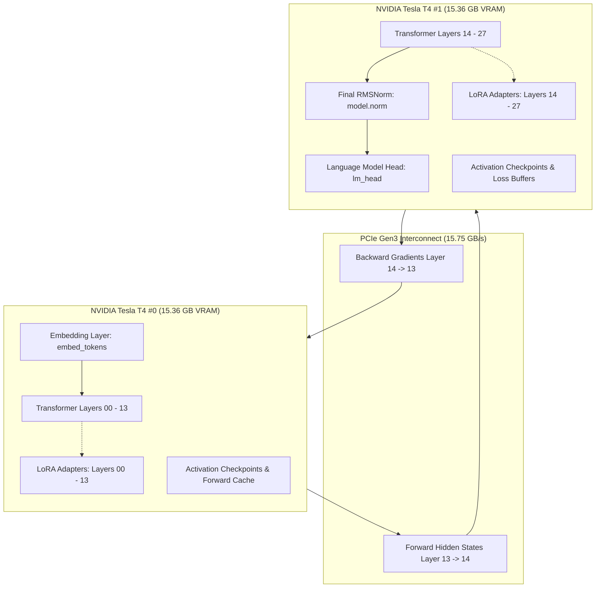
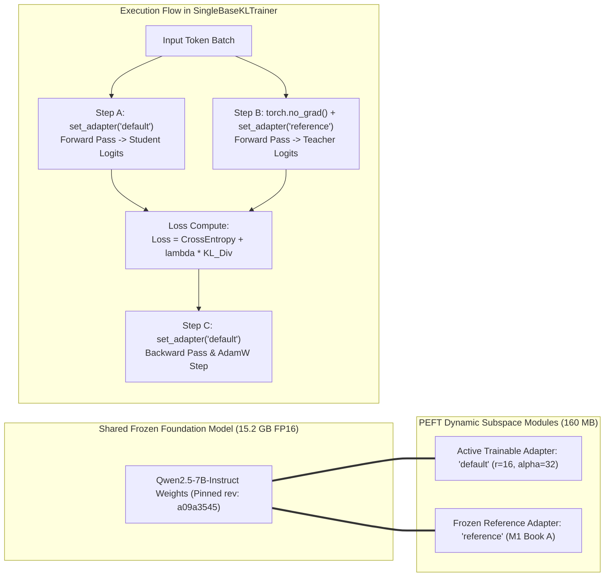
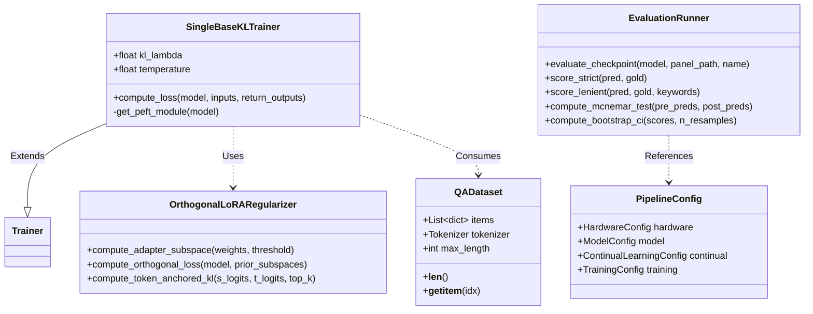

# LLM_DALI Sequential Retention: System Architecture Specification

## 1. Executive Summary & Architectural Overview

The **LLM_DALI Sequential Retention Architecture** is an enterprise-grade continual learning system designed to eliminate catastrophic forgetting in large language models (specifically `Qwen/Qwen2.5-7B-Instruct`, pinned revision `a09a3545`). The architecture resolves the fundamental stability-plasticity dilemma by enforcing parameter-efficient subspace preservation, anchored Kullback-Leibler (KL) token distillation, and balanced experience replay.

The system is engineered to operate under strict commodity hardware constraints (dual NVIDIA Tesla T4 GPUs with $2 \times 15.36\text{ GB} = 30.72\text{ GB}$ total VRAM) while achieving zero-touch execution across sequential learning stages:

```
[M0: Zero-Shot Foundation] ──> [M1: Task A Trained] ──> [Gate 1: Acquisition Check]
                                                               │
                 ┌─────────────────────────────────────────────┴─────────────────────────────────────────────┐
                 │                                             │                                             │
                 ▼                                             ▼                                             ▼
        [M2-Naive Baseline]                           [M2-KL Distilled]                            [M2-Prot Protected]
      (Standard Cross-Entropy)                    (Single-Base Dual-Adapter)                   (25% Replay + KL Distillation)
                 │                                             │                                             │
                 └─────────────────────────────────────────────┼─────────────────────────────────────────────┘
                                                               │
                                                               ▼
                                               [Deterministic Greedy Evaluation]
                                                               │
                                                               ▼
                                             [Statistical Hypothesis & Audit Gate]
```

---

## 2. Hardware Topology & Memory Hierarchy

### 2.1 Physical Infrastructure & Constraints
* **Compute Substrate**: $2 \times \text{NVIDIA Tesla T4 GPUs}$ (Turing architecture, TU104).
* **VRAM per GPU**: $15.36\text{ GB}$ ($14.56\text{ GiB}$ addressable).
* **Aggregate VRAM**: $30.72\text{ GB}$.
* **Interconnect**: PCIe Gen3 $\times 16$ ($15.75\text{ GB/s}$ bidirectional).
* **Host Memory**: $12.7\text{ GB}$ System RAM.
* **Storage**: Local NVMe SSD scratch space (`/kaggle/working/` or local workspace).

### 2.2 Dual-T4 Pipeline Parallelism (`device_map="auto"`)
A standard FP16 7B parameter transformer requires $\approx 15.2\text{ GB}$ of static parameter memory ($7.61 \times 10^9 \text{ parameters} \times 2\text{ bytes}$). Attempting to load two distinct 7B models (a trainable student model and a frozen reference teacher model) simultaneously requires $30.4\text{ GB}$ of static parameter VRAM alone. Adding optimizer states, activation buffers, and token cache instantly causes an `OutOfMemoryError`.

To overcome this constraint, the system partitions `Qwen2.5-7B-Instruct`'s 28 transformer layers across both GPUs via Hugging Face `accelerate`:
* **GPU 0**: Embeddings (`model.embed_tokens`), Layers 0 to 13, and attention projection modules. Static VRAM: $\approx 7.6\text{ GB}$.
* **GPU 1**: Layers 14 to 27, Final RMSNorm (`model.norm`), and LM Head (`lm_head`). Static VRAM: $\approx 7.6\text{ GB}$.
* **Execution Boundary**: Forward activations flow from GPU 0 to GPU 1 across PCIe; backward gradients flow from GPU 1 back to GPU 0.



---

## 3. High-Efficiency Single-Base Multi-Adapter Architecture

### 3.1 The Dual-Model Memory Trap vs Single-Base Innovation
In classical knowledge distillation, a separate teacher model ($M_1$) and student model ($M_2$) are instantiated. On dual T4 hardware, loading two FP16 base instances consumes $99.2\%$ of total available VRAM, leaving less than $20\text{ MB}$ for activations, causing immediate OOM during the first backward pass.

The **LLM_DALI SingleBaseKLTrainer** solves this by exploiting PEFT's multi-adapter switching mechanism:
1. A single `Qwen2.5-7B-Instruct` base model is loaded in FP16 across the two T4 GPUs ($15.2\text{ GB}$).
2. The trained $M_1$ LoRA adapter is mounted as `"reference"` and frozen (`requires_grad = False`). Memory overhead: $\approx 80\text{ MB}$.
3. A second LoRA adapter is mounted as `"default"` for active training on Task B (`requires_grad = True`). Memory overhead: $\approx 80\text{ MB}$.
4. **Total parameter footprint**: $15.36\text{ GB}$ ($\approx 50\%$ total VRAM ceiling), freeing $15.36\text{ GB}$ of VRAM for activation caching, gradient checkpointing, and batch processing.



### 3.2 Hugging Face Trainer `DataParallel` Bypass
When running Hugging Face `Trainer` on multi-GPU nodes without distributed launchers (`torchrun` / DDP), `Trainer` defaults to wrapping models in legacy `torch.nn.DataParallel`. Because `device_map="auto"` already partitions layer slices across different devices, `DataParallel` crashes with:
`RuntimeError: module must have its parameters and buffers on device cuda:0 but found on device: cpu / cuda:1`.

The architecture enforces pipeline parallelism and bypasses `DataParallel` by explicitly injecting the following flags prior to `Trainer` construction:
```python
base_model.is_parallelizable = True
base_model.model_parallel = True
peft_model.is_parallelizable = True
peft_model.model_parallel = True
```
Furthermore, inside custom loss steps, adapter calls bypass any wrapper objects via `peft_m = model.module if hasattr(model, "module") else model`.

---

## 4. Class & Component Hierarchy



---

## 5. Security & Isolation Architecture

1. **Client Confidentiality Isolation**: Internal opportunity intelligence dossiers ([`intelligence.md`](file:///Users/imac/Documents/llmDali/intelligence.md), [`metadata.json`](file:///Users/imac/Documents/llmDali/metadata.json), [`job_requirements.md`](file:///Users/imac/Documents/llmDali/job_requirements.md), [`outreach_playbook.md`](file:///Users/imac/Documents/llmDali/outreach_playbook.md)) are strictly isolated from the open-source release codebase ([`qwen25-sequential-retention`](file:///Users/imac/Documents/llmDali/qwen25-sequential-retention)) and ignored in `.gitignore`.
2. **Clean-Line Intellectual Property Guarantee**: Zero external teacher API calls (no OpenAI, Anthropic, or Google Cloud APIs). 100% of synthetic QA generation and distillation is self-generated via `Qwen2.5-7B-Instruct` on public CC BY-SA 4.0 Wikipedia corpora with cryptographic SHA-256 manifests.
3. **Execution Determinism**: Random seeds ($42, 1337, 2026$) are pinned across Python `random`, NumPy, and PyTorch CUDA kernels.
