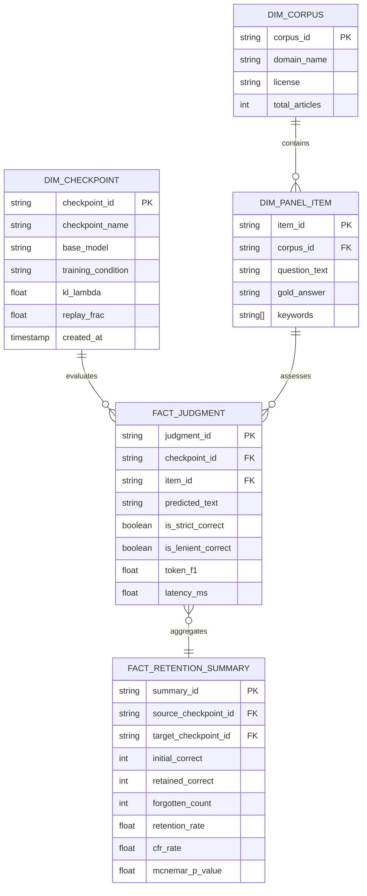

# LLM_DALI BI & Data Analytics Specification: Dimensional Marts & Retention Statistical Engine

## 1. Dimensional Architecture for Continual Learning Benchmarks

Evaluating sequential continual learning models requires transitioning from ad-hoc CSV logs to structured dimensional modeling. The dimensional model enables slice-and-dice queries across checkpoints, evaluation seeds, prompt templates, and task domains.



---

## 2. DuckDB Analytics Schema & Metric Mart DDL

The metric mart is hosted via DuckDB for in-process analytical querying over Parquet/JSONL output streams:

```sql
-- Dimension: Checkpoints
CREATE TABLE dim_checkpoints (
    checkpoint_id VARCHAR PRIMARY KEY,
    name VARCHAR NOT NULL,
    stage VARCHAR NOT NULL, -- 'M0', 'M1', 'M2'
    condition VARCHAR NOT NULL, -- 'zero_shot', 'task_a', 'naive', 'kl_distill', 'protected'
    kl_lambda DOUBLE DEFAULT 0.0,
    replay_frac DOUBLE DEFAULT 0.0
);

-- Dimension: Panel Items
CREATE TABLE dim_panel_items (
    item_id VARCHAR PRIMARY KEY,
    book_id VARCHAR NOT NULL, -- 'book_a', 'book_b'
    question VARCHAR NOT NULL,
    gold_answer VARCHAR NOT NULL,
    keywords VARCHAR[]
);

-- Fact: Judgments
CREATE TABLE fact_judgments (
    judgment_id VARCHAR PRIMARY KEY,
    checkpoint_id VARCHAR REFERENCES dim_checkpoints(checkpoint_id),
    item_id VARCHAR REFERENCES dim_panel_items(item_id),
    predicted_text VARCHAR NOT NULL,
    is_strict BOOLEAN NOT NULL,
    is_lenient BOOLEAN NOT NULL,
    token_f1 DOUBLE NOT NULL,
    latency_ms DOUBLE
);
```

---

## 3. Mathematical Formulations of Benchmark KPIs

### 3.1 Raw Accuracy Metrics
Given test panel $\mathcal{P}$ of size $N$:
$$\text{Acc}_{\text{strict}} = \frac{1}{N} \sum_{i=1}^N \mathbb{I}(\hat{y}_i \equiv y_i^*), \quad \text{Acc}_{\text{lenient}} = \frac{1}{N} \sum_{i=1}^N \mathbb{I}(\text{match}(\hat{y}_i, y_i^*))$$

### 3.2 True Item-Level Retention (Set Intersection)
A critical flaw in standard continual learning reporting is comparing aggregated percentage scores. True retention requires measuring the exact subset of items learned in Task 1 that are successfully preserved after training Task 2:
$$\mathcal{S}_{\text{learned}} = \{ i \in \mathcal{P}_A \mid M_1(x_i) = \text{Correct} \}$$
$$\mathcal{S}_{\text{retained}} = \{ i \in \mathcal{S}_{\text{learned}} \mid M_2(x_i) = \text{Correct} \}$$
$$\text{Retention Rate } (R) = \frac{|\mathcal{S}_{\text{retained}}|}{|\mathcal{S}_{\text{learned}}|} = \frac{|M_{1\text{-correct}} \cap M_{2\text{-correct}}|}{|M_{1\text{-correct}}|}$$

### 3.3 Catastrophic Forgetting Rate ($CFR$)
$$CFR = 1 - R = \frac{|\mathcal{S}_{\text{learned}} \setminus \mathcal{S}_{\text{retained}}|}{|\mathcal{S}_{\text{learned}}|}$$

### 3.4 Relative Acquisition Margin on Task B
$$\text{Acquisition Margin } (\Delta_{\text{acq}}) = \text{Acc}(M_2, \mathcal{P}_B) - \text{Acc}(M_1, \mathcal{P}_B)$$

---

## 4. Statistical Inference Engine: McNemar & Paired Bootstrap

### 4.1 McNemar's Paired Contingency Test
To evaluate whether retention differences between $M_1$ and $M_2$ variants are statistically significant, we construct paired $2 \times 2$ contingency tables:

```
                      M2 Correct        M2 Incorrect
M1 Correct           a (Retained)      b (Forgotten)
M1 Incorrect         c (Recovered)     d (Never Known)
```
When discordancy count $b + c < 25$, the **Exact Binomial Two-Tailed Test** is computed:
$$p = 2 \sum_{k=0}^{\min(b, c)} \binom{b + c}{k} 0.5^{b + c}$$
When $b + c \ge 25$, **Edwards' Continuity-Corrected $\chi^2$** is computed:
$$\chi^2 = \frac{(|b - c| - 1)^2}{b + c}, \quad \text{with } \text{df} = 1$$

### 4.2 Paired Bootstrap Confidence Intervals (5,000 Resamples)
To compute non-parametric $95\%$ confidence intervals without assuming Gaussian distribution:
```python
def compute_paired_bootstrap_ci(m1_results, m2_results, n_resamples=5000, alpha=0.05):
    n = len(m1_results)
    deltas = []
    rng = np.random.default_rng(seed=42)
    
    for _ in range(n_resamples):
        indices = rng.integers(0, n, size=n)
        sample_m1 = m1_results[indices]
        sample_m2 = m2_results[indices]
        deltas.append(sample_m2.mean() - sample_m1.mean())
        
    low = np.percentile(deltas, (alpha / 2.0) * 100)
    high = np.percentile(deltas, (1.0 - alpha / 2.0) * 100)
    return float(np.mean(deltas)), float(low), float(high)
```

---

## 5. Analytical SQL Metric Queries

### Retention Scorecard Query across All Checkpoints:
```sql
WITH m1_correct AS (
    SELECT item_id 
    FROM fact_judgments 
    WHERE checkpoint_id = 'm1' AND is_strict = TRUE
)
SELECT 
    j.checkpoint_id,
    c.name,
    c.condition,
    COUNT(j.item_id) AS total_items,
    SUM(CASE WHEN j.is_strict THEN 1 ELSE 0 END) AS raw_correct,
    ROUND(SUM(CASE WHEN j.is_strict THEN 1.0 ELSE 0.0 END) / COUNT(j.item_id) * 100, 2) AS raw_acc_pct,
    -- True Retention on M1 learned items:
    SUM(CASE WHEN j.item_id IN (SELECT item_id FROM m1_correct) AND j.is_strict THEN 1 ELSE 0 END) AS retained_items,
    ROUND(SUM(CASE WHEN j.item_id IN (SELECT item_id FROM m1_correct) AND j.is_strict THEN 1.0 ELSE 0.0 END) / 
          (SELECT COUNT(*) FROM m1_correct) * 100, 2) AS true_retention_pct,
    -- Catastrophic Forgetting Rate:
    ROUND((1.0 - SUM(CASE WHEN j.item_id IN (SELECT item_id FROM m1_correct) AND j.is_strict THEN 1.0 ELSE 0.0 END) / 
          (SELECT COUNT(*) FROM m1_correct)) * 100, 2) AS catastrophic_forgetting_pct
FROM fact_judgments j
JOIN dim_checkpoints c ON j.checkpoint_id = c.checkpoint_id
WHERE j.item_id IN (SELECT item_id FROM dim_panel_items WHERE book_id = 'book_a')
GROUP BY j.checkpoint_id, c.name, c.condition
ORDER BY true_retention_pct DESC;
```
