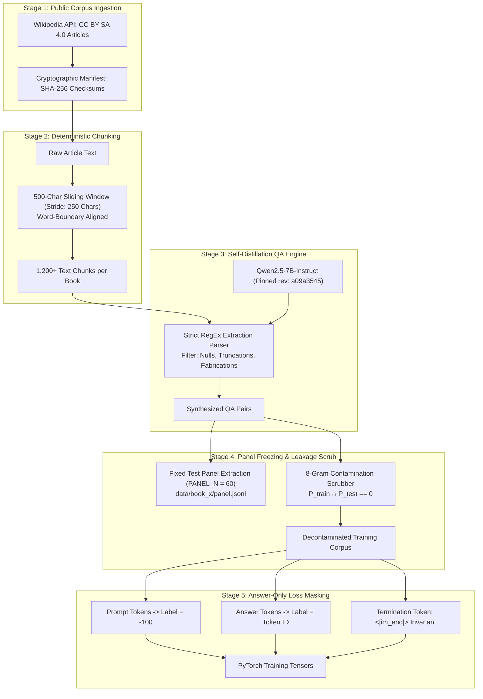
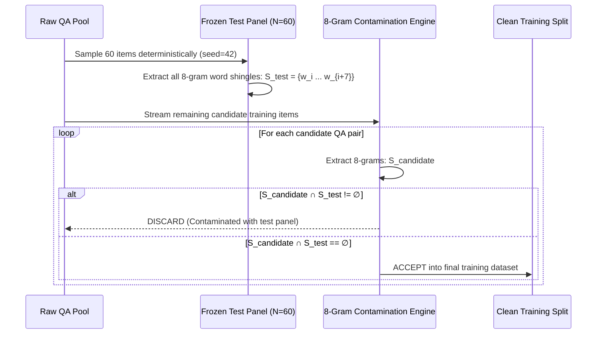

# LLM_DALI Sequential Retention: End-to-End Data Flow Specification

## 1. Data Pipeline Overview

The data pipeline transforms uncurated, public-domain encyclopedia corpora into rigorously validated, leak-free, answer-masked instruction tuning datasets and deterministic evaluation panels.



---

## 2. Ingestion & Cryptographic Manifest

### 2.1 Public Domain Knowledge Corpora
To ensure zero IP contamination and reproducible distribution, training corpora are sourced from Wikipedia under the Creative Commons Attribution-ShareAlike 4.0 International (CC BY-SA 4.0) license:
* **Book A (Domain: Quantum Physics & Condensed Matter)**:
  * Superconductivity, Quantum Hall effect, Topological insulator, Bose–Einstein condensate, Quantum entanglement, Quantum teleportation, Josephson effect, SQUID, Graphene, Quantum dot.
* **Book B (Domain: Molecular Biology & Epigenetics)**:
  * CRISPR gene editing, Epigenetics, DNA methylation, Histone modification, RNA interference, Telomere, Ribosome, Chromatin remodeling, Stem cell, Optogenetics.

### 2.2 Cryptographic Hash Tracking (`manifest.json`)
Every ingested article is hashed via SHA-256 upon retrieval to ensure byte-level identity:
```json
{
  "book_a": {
    "articles": [
      {
        "title": "Superconductivity",
        "url": "https://en.wikipedia.org/wiki/Superconductivity",
        "sha256": "4a7f9b8c...",
        "char_count": 48210
      }
    ]
  }
}
```

---

## 3. Sliding Window Text Chunking

Text extraction splits long-form articles into bounded semantic units suitable for single-question synthesis:
* **Window Length ($W$)**: 500 characters.
* **Stride Length ($S$)**: 250 characters ($50\%$ overlap between adjacent chunks).
* **Boundary Alignment**: Chunks are truncated or expanded to align with word boundaries (`\s`) to avoid severed tokens.
* **Filter Rule**: Chunks with length $< 200$ characters are discarded.

---

## 4. Self-Distillation Engine & Strict RegEx Parser

### 4.1 Teacher Prompting Contract
Zero external APIs (OpenAI, Anthropic) are used. The teacher model is `Qwen2.5-7B-Instruct` itself, operating under zero-shot system instructions:
```
<|im_start|>system
You write questions from a scientific excerpt. Given an excerpt, write exactly one factual question that can be answered solely from the excerpt, followed by the concise answer. Use this exact format:
Question: <your question>
Answer: <your concise answer>
Do not repeat the excerpt. Keep the answer under 25 words.<|im_end|>
<|im_start|>user
Excerpt:
{chunk_text}<|im_end|>
<|im_start|>assistant
```

### 4.2 RegEx Parsing & Rejection Filter
Generations must strictly adhere to the key-value schema:
```python
pattern = re.compile(
    r"Question:\s*(?P<q>[^\n]+)\s*\nAnswer:\s*(?P<a>[^\n]+)", 
    re.IGNORECASE
)
```
**Rejection Rules**:
1. If the generation fails regex matching, it is rejected (no fallback hallucinations).
2. If the answer contains generic non-answers (`"Not mentioned"`, `"Unknown"`, `"Cannot be determined"`), it is discarded.
3. If the answer exceeds 35 words or repeats $>70\%$ of the question tokens, it is rejected.

---

## 5. Decontamination via 8-Gram Intersection Scrub

To guarantee scientific validity and eliminate data snooping, the training split undergoes strict n-gram decontamination against the frozen test panel:



---

## 6. Tokenization Invariants & Answer-Only Masking

During instruction fine-tuning, standard causal language modeling computes loss across all tokens, including the prompt. This causes models to overfit to the user prompt syntax rather than the factual answer. The LLM_DALI dataset enforces **Answer-Only Loss Masking**:

```
Token Stream:
[<|im_start|>] [system] [...] [<|im_end|>] [<|im_start|>] [user] [...] [<|im_end|>] [<|im_start|>] [assistant] [\n] [Answer Tokens...] [<|im_end|>]
Labels Stream:
[   -100     ] [ -100 ] [...] [  -100  ] [   -100    ] [ -100 ] [...] [  -100  ] [   -100    ] [   -100    ] [ -100] [ Token IDs...   ] [  151645   ]
|◄────────────────────────── MASKED TO -100 (LOSS = 0) ──────────────────────────►|                     |◄────── ACTIVE LOSS GRADIENTS ──────►|
```

### Critical Delimiter Invariant
* Every prompt MUST conclude with `<|im_start|>assistant\n`.
* Every target answer MUST terminate with the end-of-turn token `<|im_end|>` (Token ID `151645`).
* **Failure consequence**: Omitting `<|im_end|>` prevents the network from learning when to cease generation, causing greedy decoding to run continuously until `max_new_tokens` is exhausted and yielding 0 on strict parsing.
