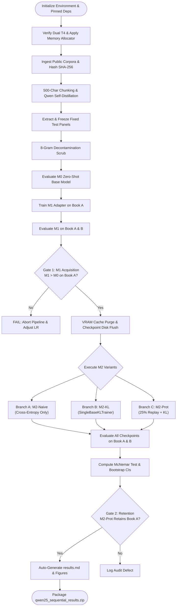

# LLM_DALI Sequential Retention: Operational Workflow & Execution Protocol

## 1. End-to-End Execution Lifecycle

The operational workflow spans 13 discrete steps structured around deterministic quality gates. Execution proceeds linearly through base establishment (M0), first-task acquisition (M1), and triple-branch sequential training (M2 Naive vs. M2 KL vs. M2 Protected).



---

## 2. Step-by-Step Execution Protocols

### Step 1: Environment & CUDA Alignment
* Ensure `torchao` incompatible versions are monkey-patched (`is_torchao_available = lambda: False`).
* Set `PYTORCH_CUDA_ALLOC_CONF="expandable_segments:True"` to prevent virtual address fragmentation across dual T4 GPUs.
* Verify GPUs via `nvidia-smi` and confirm 2 devices visible to PyTorch.

### Step 2: Public Corpus Ingestion & Hash Manifest
* Retrieve 10 Wikipedia articles per domain under CC BY-SA 4.0.
* Compute SHA-256 digests for each article and commit to `data/manifest.json`.

### Step 3: Self-Distillation QA Generation
* Instantiate `Qwen2.5-7B-Instruct` in native FP16 (`device_map="auto"`).
* Process chunks using system prompt: `Question: <q>\nAnswer: <a>`.
* Reject non-conforming generations via strict regex matching.

### Step 4: Fixed Panel Freezing & 8-Gram Contamination Scrub
* Sample $N=60$ (or $N=150$) QA pairs deterministically (`seed=42`) and save to `data/book_a/panel.jsonl` and `data/book_b/panel.jsonl`.
* Build 8-gram shingle sets of panel questions and answers.
* Remove any candidate training item containing an 8-gram match with the panel.

### Step 5: M0 Zero-Shot Baseline Evaluation
* Run greedy evaluation (`temperature=0.0, max_new_tokens=40`) on Book A and Book B panels.
* Compute both **Strict Match** (exact normalized substring) and **Lenient Match** (fuzzy token recall $\ge 0.50$ / key entity presence).
* Write outputs to `outputs/judgments_m0_book_a.jsonl` and `outputs/judgments_m0_book_b.jsonl`.

### Step 6: M1 LoRA Adaptation on Book A
* Initialize trainable LoRA adapter ($r=16, \alpha=32$) on `Qwen2.5-7B-Instruct`.
* Train for 3 epochs with AdamW, learning rate $1.5 \times 10^{-4}$, cosine scheduler.
* Save weights to `./checkpoints/m1`.

### Step 7: Gate 1 Validation (First-Task Acquisition)
* Evaluate M1 on Book A and Book B panels.
* **Gate 1 Condition**: Score(M1, Book A) must strictly exceed Score(M0, Book A).
* If M1 fails to acquire knowledge, training halts immediately to prevent wasted compute.

### Step 8: VRAM Purge Protocol & Checkpoint Disk Flushing
* Deep learning models and PEFT wrappers must be explicitly deleted:
  ```python
  del model, trainer, base_model
  gc.collect()
  torch.cuda.empty_cache()
  ```
* Ensures zero GPU memory leakage before commencing multi-adapter sequential training.

### Step 9: Sequential M2 Multi-Condition Branching
* **Condition A (`m2_naive`)**: Load M1 weights into trainable adapter; train on Book B using standard Cross-Entropy loss ($lr = 1.5 \times 10^{-4}$). This establishes the catastrophic forgetting upper bound.
* **Condition B (`m2_kl`)**: Load M1 weights; mount reference adapter (`"reference"`, frozen) and training adapter (`"default"`, trainable). Train on Book B with `SingleBaseKLTrainer` ($\lambda_{\text{KL}} = 1.0, lr = 1.0 \times 10^{-4}$).
* **Condition C (`m2_prot`)**: Train on Book B with $25\%$ replay buffer from Book A training data + anchored KL distillation ($\lambda_{\text{KL}} = 0.5, \gamma = 0.25, lr = 1.0 \times 10^{-4}$).

### Step 10: Multi-Checkpoint Evaluation & Judgment Logging
* Sequentially evaluate every M2 variant on both Book A and Book B panels.
* Every model prediction, ground truth, latency, and strict/lenient judgment is persisted to disk to guarantee full auditability.

### Step 11: Statistical Hypothesis Testing & Audit Gates
* Construct $2 \times 2$ contingency tables comparing item-level correctness between M1 and each M2 variant on Book A:
  ```
                   M2_variant Correct    M2_variant Incorrect
  M1 Correct              a                     b (Forgotten)
  M1 Incorrect            c (Recovered)         d
  ```
* Compute exact two-tailed McNemar's test with continuity correction:
  $$\chi^2 = \frac{(|b - c| - 1)^2}{b + c}, \quad p = 2 \sum_{k=0}^{\min(b, c)} \binom{b+c}{k} 0.5^{b+c}$$
* Compute $95\%$ empirical bootstrap confidence intervals over 5,000 resamples.

### Step 12: Automated Reporting & Distribution Packaging
* Automatically synthesize `results.md` from serialized JSONL records (no manual copy-pasting).
* Package code, manifests, and metrics into `qwen25_sequential_results.zip`.

---

## 3. Failure Modes & Self-Healing Protocols

| Failure Symptom | Underlying Root Cause | Automated Architectural Remedy |
| :--- | :--- | :--- |
| **CUDA OOM on Distillation Step** | Instantiating 2 full 7B base models ($30.4\text{ GB}$) exceeds dual T4 VRAM. | Deploy **SingleBaseKLTrainer**: Mount 2 lightweight LoRA adapters on 1 shared base model ($15.36\text{ GB}$ total). |
| **`DataParallel` Crash on Multi-GPU** | Hugging Face `Trainer` auto-wraps pipeline-parallel models in `torch.nn.DataParallel`. | Set `is_parallelizable = True` and `model_parallel = True` on base and PEFT models prior to `Trainer` instantiation. |
| **Evaluations Score 0 / Infinite Loops** | Target answers lacked `<|im_end|>` termination tokens during training. | Strict enforcement of `<|im_end|>` (token ID `151645`) in dataset formatting and label generation. |
| **Contamination / Snooping** | Training items share substrings with test panels. | Run **8-Gram Intersection Scrubber**; discard all candidate pairs with overlapping 8-grams. |
| **Kernel Restart Memory Loss** | Execution interrupted midway through multi-hour runs. | All evaluation judgments and dataset splits are auto-restored from disk cache if files already exist. |
